```{=html}
<div class="skill-filter gal-filter">
  <button class="active" data-filter="all">All (11)</button>
  <button data-filter="r">R · ggplot2 (8)</button>
  <button data-filter="deneb">Deneb (2)</button>
  <button data-filter="pbi">Power BI dashboards (1)</button>
</div>
<div class="gallery">
  <figure class="g-item" data-tool="pbi" tabindex="0" data-src="projects/oee-dashboard/oee_dashboard.jpg" data-title="Overall Equipment Effectiveness" data-sub="Power BI · interactive dashboard" data-link="projects/oee-dashboard/index.html">
   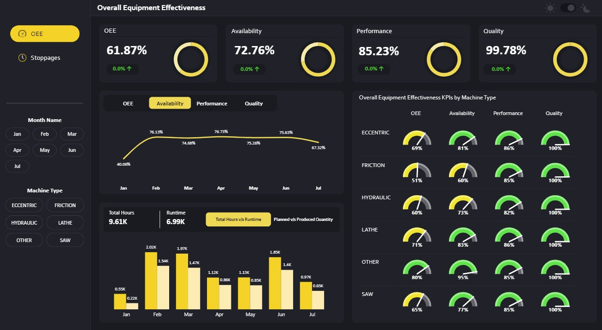
   <figcaption><b>Overall Equipment Effectiveness</b><span>Power BI · interactive dashboard</span></figcaption>
  </figure>
  <figure class="g-item" data-tool="r" tabindex="0" data-src="projects/education-inequality/01_scores_by_type.jpg" data-title="Whatever the school type, the typical score is about 70%" data-sub="Same Money, Same Scores? · strip plot" data-link="projects/education-inequality/index.html">
   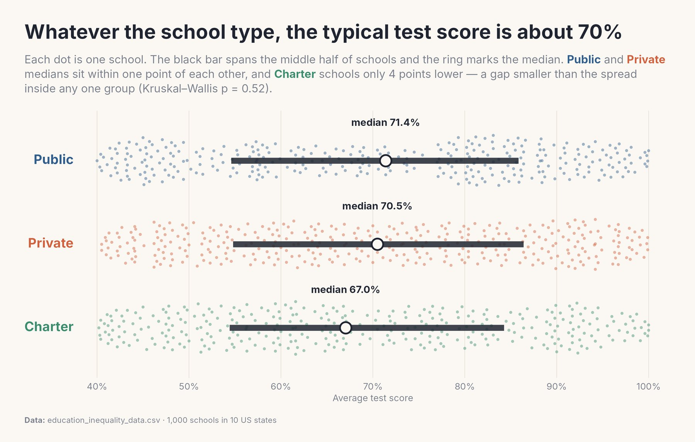
   <figcaption><b>Whatever the school type, the typical score is about 70%</b><span>Same Money, Same Scores? · strip plot</span></figcaption>
  </figure>
  <figure class="g-item" data-tool="r" tabindex="0" data-src="projects/kenya-progression/k1_flow.jpg" data-title="Nearly one in three graduates was never admitted" data-sub="From KCSE to Graduation · alluvial flow" data-link="projects/kenya-progression/index.html">
   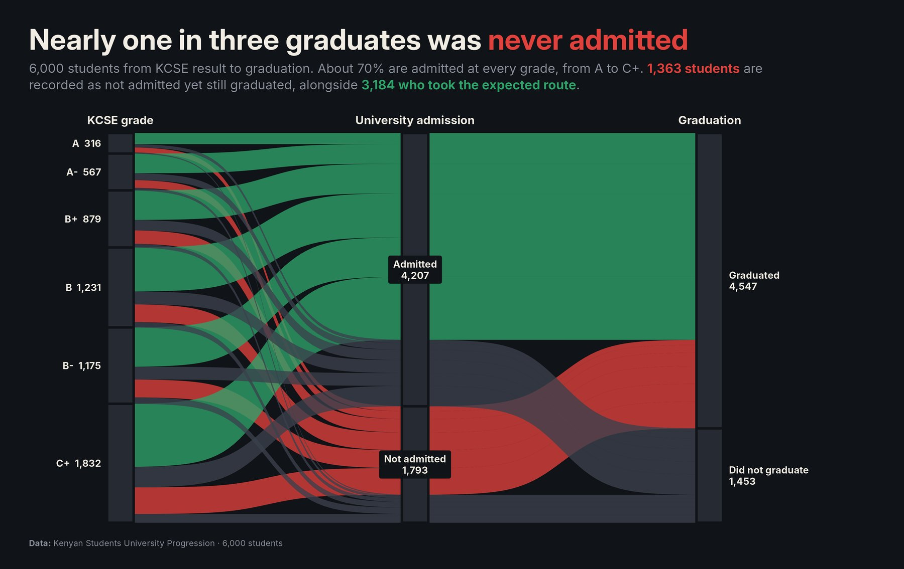
   <figcaption><b>Nearly one in three graduates was never admitted</b><span>From KCSE to Graduation · alluvial flow</span></figcaption>
  </figure>
  <figure class="g-item" data-tool="deneb" tabindex="0" data-src="projects/deneb-visuals/drought_heatmap.jpg" data-title="Arizona's drought, week by week" data-sub="Deneb · heatmap" data-link="projects/deneb-visuals/index.html">
   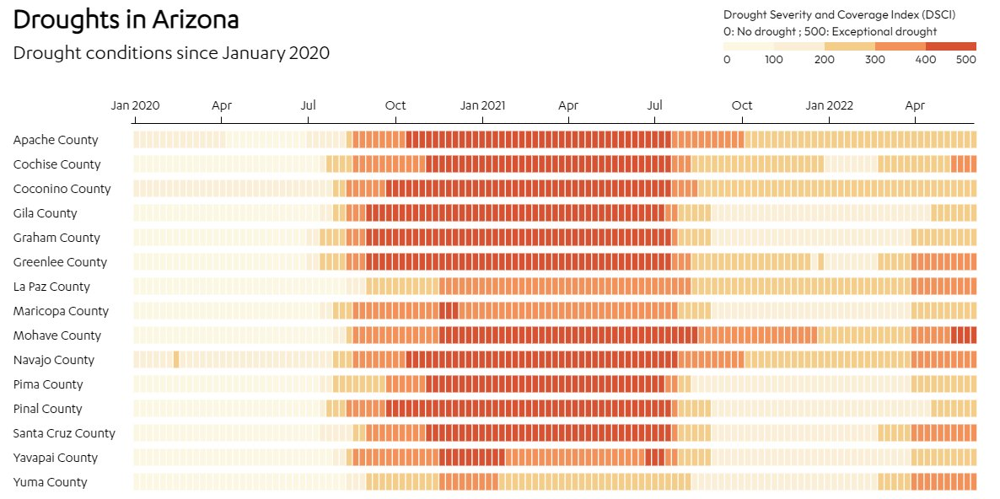
   <figcaption><b>Arizona's drought, week by week</b><span>Deneb · heatmap</span></figcaption>
  </figure>
  <figure class="g-item" data-tool="r" tabindex="0" data-src="projects/education-inequality/02_funding_vs_scores.jpg" data-title="Spending five times more barely moves scores" data-sub="Same Money, Same Scores? · small multiples" data-link="projects/education-inequality/index.html">
   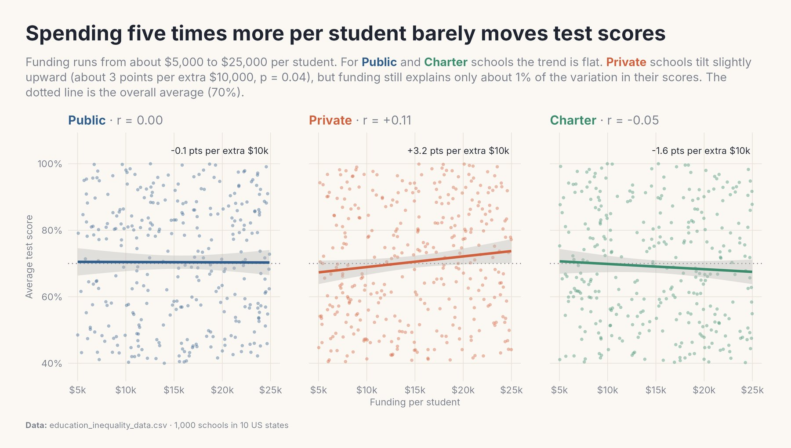
   <figcaption><b>Spending five times more barely moves scores</b><span>Same Money, Same Scores? · small multiples</span></figcaption>
  </figure>
  <figure class="g-item" data-tool="r" tabindex="0" data-src="projects/kenya-progression/k2_ridges.jpg" data-title="An A and a C+ look the same on paper" data-sub="From KCSE to Graduation · ridgelines" data-link="projects/kenya-progression/index.html">
   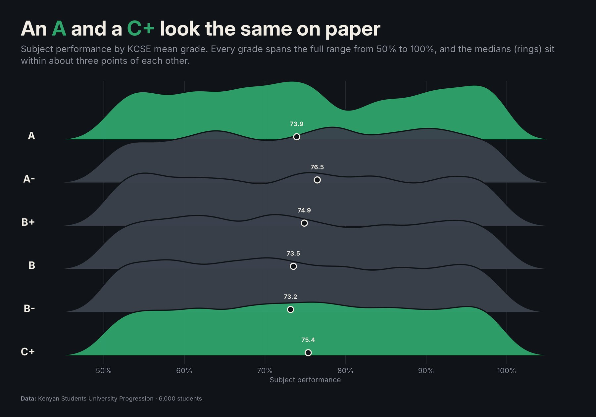
   <figcaption><b>An A and a C+ look the same on paper</b><span>From KCSE to Graduation · ridgelines</span></figcaption>
  </figure>
  <figure class="g-item" data-tool="r" tabindex="0" data-src="projects/education-inequality/03_poverty_funding_grid.jpg" data-title="Rich or poor, well funded or not, scores barely move" data-sub="Same Money, Same Scores? · tile grid" data-link="projects/education-inequality/index.html">
   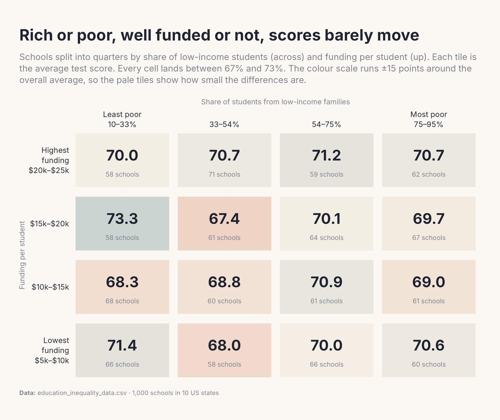
   <figcaption><b>Rich or poor, well funded or not, scores barely move</b><span>Same Money, Same Scores? · tile grid</span></figcaption>
  </figure>
  <figure class="g-item" data-tool="deneb" tabindex="0" data-src="projects/deneb-visuals/energy_small_multiples.jpg" data-title="Energy under changing skies" data-sub="Deneb · 53 small multiples" data-link="projects/deneb-visuals/index.html">
   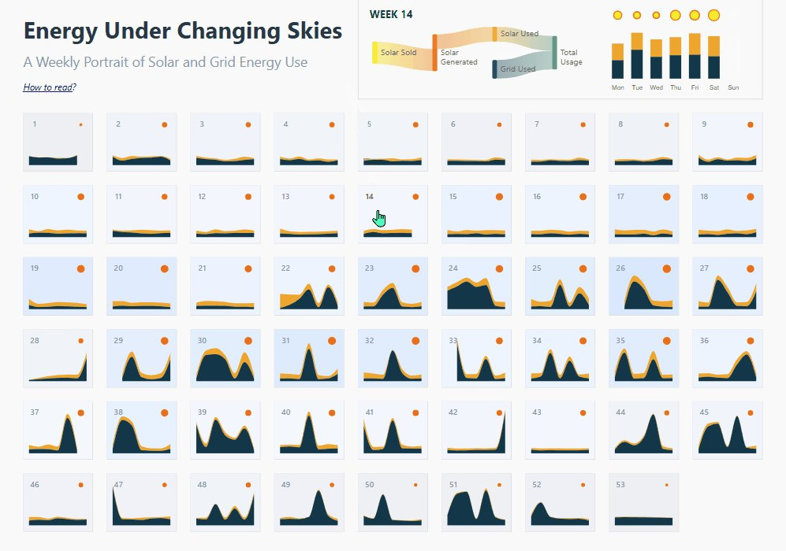
   <figcaption><b>Energy under changing skies</b><span>Deneb · 53 small multiples</span></figcaption>
  </figure>
  <figure class="g-item" data-tool="r" tabindex="0" data-src="projects/kenya-progression/k3_time.jpg" data-title="Time to graduate piles up at the edges" data-sub="From KCSE to Graduation · lollipop histogram" data-link="projects/kenya-progression/index.html">
   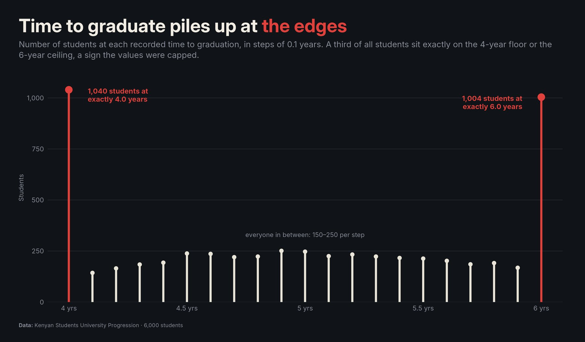
   <figcaption><b>Time to graduate piles up at the edges</b><span>From KCSE to Graduation · lollipop histogram</span></figcaption>
  </figure>
  <figure class="g-item" data-tool="r" tabindex="0" data-src="projects/education-inequality/04_states.jpg" data-title="California tops the table, but the gaps are small and uncertain" data-sub="Same Money, Same Scores? · intervals" data-link="projects/education-inequality/index.html">
   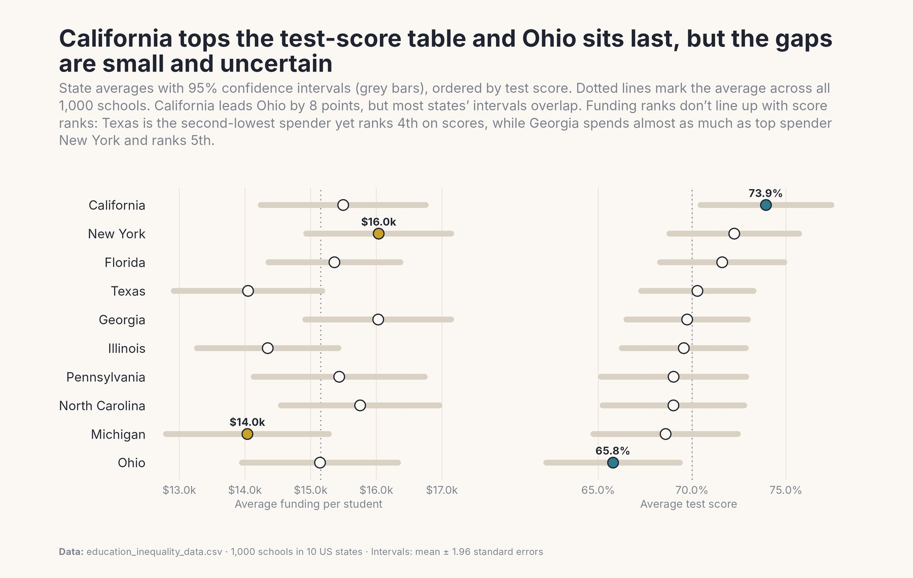
   <figcaption><b>California tops the table, but the gaps are small and uncertain</b><span>Same Money, Same Scores? · intervals</span></figcaption>
  </figure>
  <figure class="g-item" data-tool="r" tabindex="0" data-src="projects/kenya-progression/k4_groups.jpg" data-title="Income, region, gender or school: the rates barely move" data-sub="From KCSE to Graduation · dumbbells" data-link="projects/kenya-progression/index.html">
   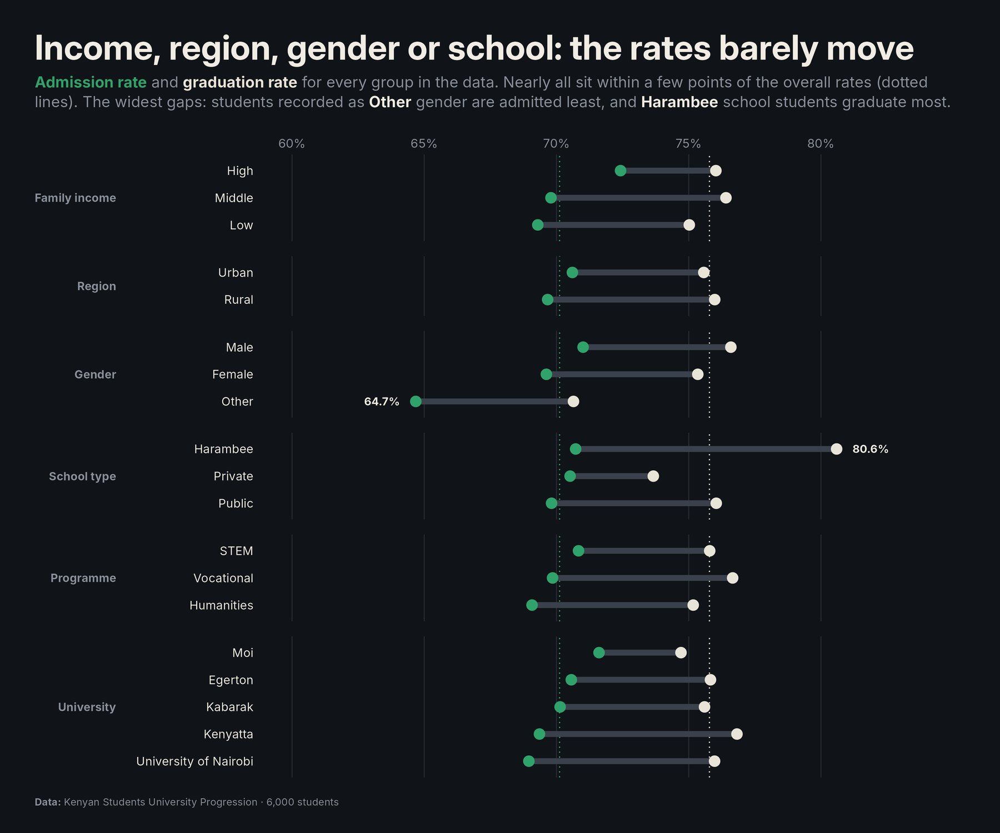
   <figcaption><b>Income, region, gender or school: the rates barely move</b><span>From KCSE to Graduation · dumbbells</span></figcaption>
  </figure>
</div>

<div class="lb" hidden>
  <button class="lb-close" aria-label="Close">×</button>
  <button class="lb-prev" aria-label="Previous">‹</button>
  <figure><figcaption><b></b><span></span><a class="btn-mo primary" href="#">Read the story →</a></figcaption></figure>
  <button class="lb-next" aria-label="Next">›</button>
</div>
```
