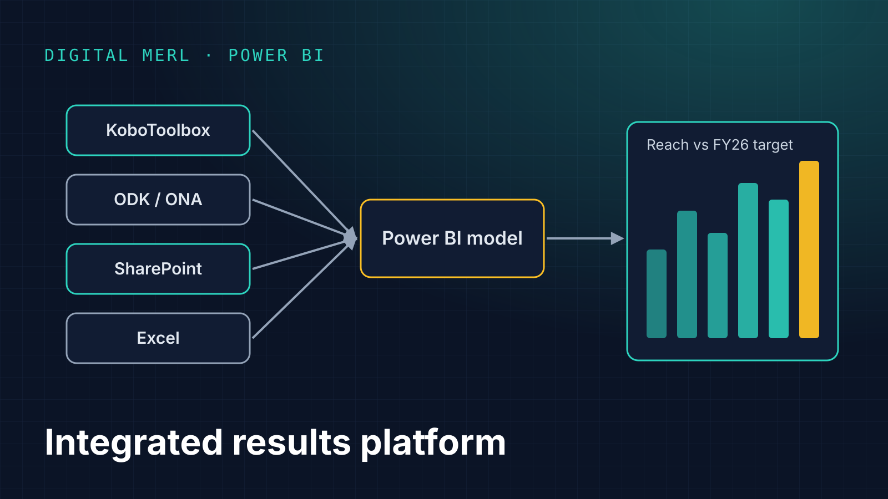
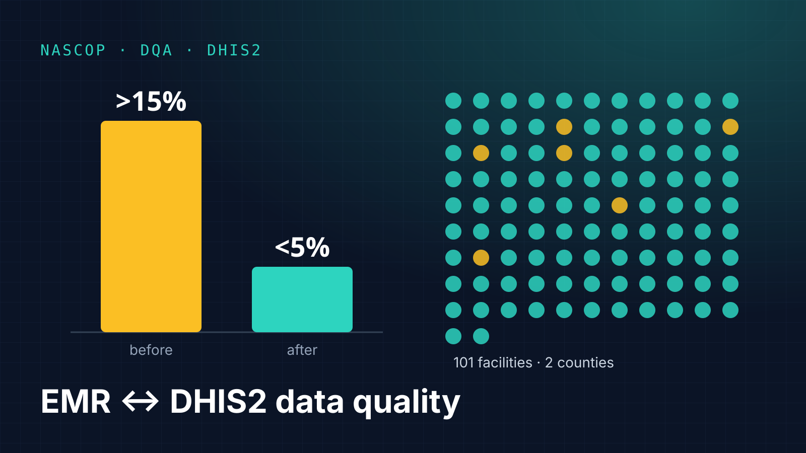
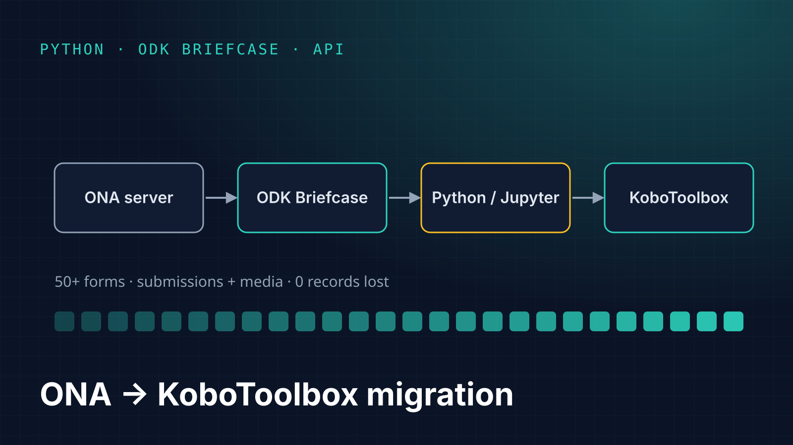

```{=html}
<style>#title-block-header{display:none}</style>
<div class="mo-wide">

<!-- ================= HERO ================= -->
<section class="hero">
  <div class="hero-grid">
    <div>
      <div class="eyebrow">Data Systems &amp; Digital MERL Specialist · Nairobi, Kenya</div>
      <h1>I turn field data into <span class="grad">decisions</span> that programmes can trust.</h1>
      <div class="typed" data-words='["Power BI · DAX · Power Query","R · tidyverse · R Markdown","Python · pandas · Jupyter","SQL · BigQuery · data models","KoboToolbox · ODK · XLSForm","DHIS2 · EMR · data quality"]'></div>
      <p class="lead">10+ years building databases, dashboards, digital data-collection tools and data-quality systems for multi-country humanitarian, public-health and research programmes across Africa.</p>
      <div class="btn-row">
        <a class="btn-mo primary" href="projects/index.html">View projects →</a>
        <a class="btn-mo ghost" href="experience.html">Experience</a>
        <a class="btn-mo ghost" href="contact.html">Get in touch</a>
      </div>
    </div>

    <!-- mock dashboard panel -->
    <div class="hero-panel" aria-label="Illustrative dashboard">
      <div class="panel-title"><span>results_platform.pbix</span><span class="dots"><span style="background:#f87171"></span><span style="background:#fbbf24"></span><span style="background:#34d399"></span></span></div>
      <svg viewBox="0 0 420 300" width="100%" role="img" aria-label="Illustrative reach versus target chart">
        <rect x="0" y="0" width="130" height="64" rx="10" fill="#111c33"/>
        <text x="12" y="24" font-size="11" fill="#94a3b8">Country offices</text>
        <text x="12" y="52" font-size="26" font-weight="700" fill="#5eead4">6</text>
        <rect x="145" y="0" width="130" height="64" rx="10" fill="#111c33"/>
        <text x="157" y="24" font-size="11" fill="#94a3b8">Dashboards</text>
        <text x="157" y="52" font-size="26" font-weight="700" fill="#5eead4">10+</text>
        <rect x="290" y="0" width="130" height="64" rx="10" fill="#111c33"/>
        <text x="302" y="24" font-size="11" fill="#94a3b8">Reporting days</text>
        <text x="302" y="52" font-size="26" font-weight="700" fill="#fbbf24">14→7</text>
        <rect x="0" y="78" width="420" height="214" rx="10" fill="#111c33"/>
        <text x="14" y="102" font-size="12" fill="#cbd5e1">Reach vs target by quarter (illustrative)</text>
        <g>
          <rect x="40"  y="200" width="34" height="70"  rx="4" fill="#2dd4bf" opacity=".55"><animate attributeName="height" from="0" to="70" dur=".8s" fill="freeze"/><animate attributeName="y" from="270" to="200" dur=".8s" fill="freeze"/></rect>
          <rect x="130" y="170" width="34" height="100" rx="4" fill="#2dd4bf" opacity=".7"><animate attributeName="height" from="0" to="100" dur=".9s" fill="freeze"/><animate attributeName="y" from="270" to="170" dur=".9s" fill="freeze"/></rect>
          <rect x="220" y="140" width="34" height="130" rx="4" fill="#2dd4bf" opacity=".85"><animate attributeName="height" from="0" to="130" dur="1s" fill="freeze"/><animate attributeName="y" from="270" to="140" dur="1s" fill="freeze"/></rect>
          <rect x="310" y="120" width="34" height="150" rx="4" fill="#2dd4bf"><animate attributeName="height" from="0" to="150" dur="1.1s" fill="freeze"/><animate attributeName="y" from="270" to="120" dur="1.1s" fill="freeze"/></rect>
          <polyline points="57,185 147,160 237,140 327,128" fill="none" stroke="#fbbf24" stroke-width="2.5" stroke-dasharray="5 4"/>
          <text x="352" y="124" font-size="11" fill="#fbbf24">target</text>
          <text x="46" y="286" font-size="11" fill="#94a3b8">Q1</text><text x="136" y="286" font-size="11" fill="#94a3b8">Q2</text><text x="226" y="286" font-size="11" fill="#94a3b8">Q3</text><text x="316" y="286" font-size="11" fill="#94a3b8">Q4</text>
        </g>
      </svg>
    </div>
  </div>
</section>

<!-- ================= KPI TILES ================= -->
<div class="kpis">
  <div class="kpi reveal"><div class="num">15% → &lt;5%</div><div class="lbl">EMR-to-DHIS2 reporting discrepancy cut across 101 facilities (NASCOP)</div></div>
  <div class="kpi reveal"><div class="num"><span class="count" data-to="50" data-suffix="+">50+</span></div><div class="lbl">forms migrated from ONA to KoboToolbox with zero data loss</div></div>
  <div class="kpi reveal"><div class="num"><span class="count" data-to="6">6</span> countries</div><div class="lbl">multi-country M&amp;E systems supported at World Relief</div></div>
  <div class="kpi reveal"><div class="num"><span class="count" data-to="50" data-suffix="+">50+</span></div><div class="lbl">staff trained on Kobo/ODK, data quality and Power BI</div></div>
</div>

<!-- ================= WHAT I DO ================= -->
<section class="section-block reveal">
  <div class="section-head"><div><div class="eyebrow">What I do</div><h2 class="section">End-to-end results systems</h2>
  <p class="muted" style="max-width:46rem">From the first XLSForm question to the dashboard a country director opens on Monday morning: collection → validation → storage → integration → reporting.</p></div></div>
  <div class="grid-3">
    <div class="card-mo"><div class="icon-badge"><i class="bi bi-bar-chart-line"></i></div><h3>Dashboards &amp; automated reporting</h3><p>Power BI models with DAX and Power Query, star schemas and indicator counting rules, built for leadership, donors and field teams.</p><div class="chips"><span class="chip">Power BI</span><span class="chip">DAX</span><span class="chip">Power Query (M)</span><span class="chip">Excel</span></div></div>
    <div class="card-mo"><div class="icon-badge"><i class="bi bi-diagram-3"></i></div><h3>Data engineering &amp; integration</h3><p>Linking Kobo, ODK/ONA, SharePoint, BigQuery and Excel into one reliable model. API transfers, migrations and reproducible pipelines.</p><div class="chips"><span class="chip">SQL</span><span class="chip">BigQuery</span><span class="chip">Python</span><span class="chip">APIs</span></div></div>
    <div class="card-mo"><div class="icon-badge"><i class="bi bi-shield-check"></i></div><h3>Data quality &amp; digital MERL</h3><p>XLSForms with skip logic and constraints, DQA frameworks, deduplication and reconciliation, so the numbers hold up under audit.</p><div class="chips"><span class="chip">KoboToolbox</span><span class="chip">ODK</span><span class="chip">DHIS2</span><span class="chip amber">DQA</span></div></div>
  </div>
</section>

<!-- ================= FEATURED PROJECTS ================= -->
<section class="section-block reveal">
  <div class="section-head"><div><div class="eyebrow">Selected work</div><h2 class="section">Featured projects</h2></div><a href="projects/index.html">All projects →</a></div>
  <div class="grid-3">
    <a class="proj" href="projects/results-platform/index.html"><div class="body"><div class="chips"><span class="chip">Power BI</span><span class="chip">SharePoint</span><span class="chip">Kobo</span></div><h3>Integrated multi-country results platform</h3><p>One view of reach against FY26 strategy targets across 6 country offices and 10+ projects.</p><div class="impact">▲ reporting turnaround 14 → 7 days</div></div></a>
    <a class="proj" href="projects/dhis2-data-quality/index.html"><div class="body"><div class="chips"><span class="chip">DHIS2</span><span class="chip">EMR</span><span class="chip amber">DQA</span></div><h3>EMR ↔ DHIS2 data-quality programme</h3><p>Routine checks, verification visits and feedback loops across 101 HIV-care facilities.</p><div class="impact">▼ discrepancy &gt;15% → &lt;5%</div></div></a>
    <a class="proj" href="projects/ona-kobo-migration/index.html"><div class="body"><div class="chips"><span class="chip">Python</span><span class="chip">Jupyter</span><span class="chip">API</span></div><h3>ONA → KoboToolbox migration pipeline</h3><p>A repeatable export–transform–upload workflow built with ODK Briefcase and Python.</p><div class="impact">✓ 50+ forms · zero data loss</div></div></a>
  </div>
</section>

<!-- ================= CREDENTIALS STRIP ================= -->
<section class="section-block reveal">
  <div class="grid-2">
    <div class="card-mo">
      <div class="eyebrow">Credentials</div>
      <h3 style="margin-top:.6rem">Certified, and still learning</h3>
      <ul class="tool-list">
        <li><span><b>Microsoft Certified: Power BI Data Analyst Associate</b> (PL-300)</span><span class="use">2024</span></li>
        <li><span><b>MSc Data Analytics</b>, Nexford University</span><span class="use">expected 2027</span></li>
        <li><span><b>Python Basics &amp; Beyond</b>, The GRAPH Courses</span><span class="use">2025</span></li>
        <li><span><b>BSc Information Management</b>, Kenyatta University</span><span class="use">2015</span></li>
      </ul>
    </div>
    <div class="card-mo">
      <div class="eyebrow">Where I've worked</div>
      <h3 style="margin-top:.6rem">Humanitarian · public health · research</h3>
      <ul class="tool-list">
        <li><span><b>World Relief</b>: Data Analytics &amp; Impact Officer</span><span class="use">2021 – now</span></li>
        <li><span><b>Moses Analytics</b>: Founder &amp; Lead Trainer</span><span class="use">2026 – now</span></li>
        <li><span><b>NASCOP</b>: Data Management Assistant</span><span class="use">2017 – 2021</span></li>
        <li><span><b>KEMRI</b>: Data &amp; Health Records Officer</span><span class="use">2015 – 2017</span></li>
      </ul>
    </div>
  </div>
</section>

<!-- ================= CTA ================= -->
<section class="section-block reveal">
  <div class="hero" style="padding:2.4rem 2.4rem;text-align:center">
    <h2 style="color:#fff;border:0;margin:0 0 .6rem">Need a results system, a dashboard or a data-skills training?</h2>
    <p class="lead" style="margin:0 auto">I work with NGOs, health programmes and research teams. I also run applied Power BI and R training through Moses Analytics.</p>
    <div class="btn-row" style="justify-content:center"><a class="btn-mo primary" href="contact.html">Start a conversation</a><a class="btn-mo ghost" href="skills.html">See my toolkit</a></div>
  </div>
</section>

</div>
```
