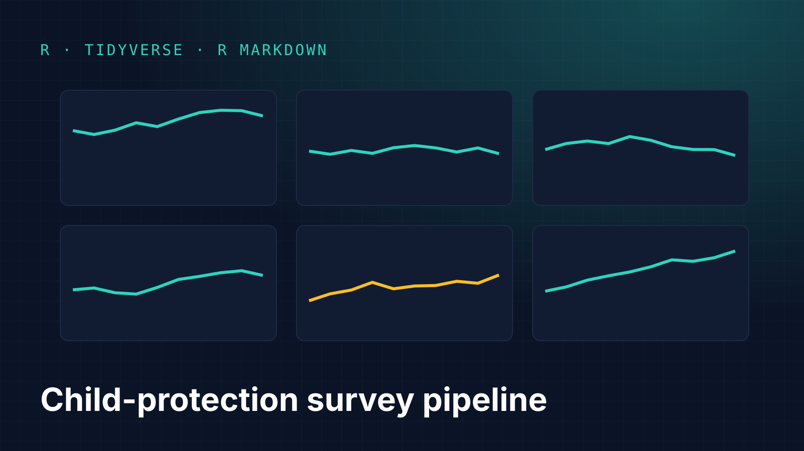

```{=html}
<div class="cs-hero"></div>
<div class="facts"><div class="fact"><div class="k">Client</div><div class="v">Moses Analytics</div></div><div class="fact"><div class="k">Source</div><div class="v">ODK survey</div></div><div class="fact"><div class="k">Stack</div><div class="v">R · tidyverse · ggplot2</div></div><div class="fact"><div class="k">Output</div><div class="v">R Markdown reports</div></div></div>
```

## Approach

- **Import and clean** ODK exports: label choices, handle `select_multiple` columns, check skip-logic consistency.
- **Derive KPI variables** once, in one script, from documented definitions.
- **Reusable plotting functions** so every chart shares the same style and annotation.
- **R Markdown reports** that rebuild from raw data in a single run.

```r
plot_kpi <- function(df, kpi, by) {
  df |>
    group_by({{ by }}) |>
    summarise(pct = mean({{ kpi }}, na.rm = TRUE)) |>
    ggplot(aes(pct, fct_reorder({{ by }}, pct))) +
    geom_col(fill = "#0f766e") +
    scale_x_continuous(labels = scales::percent) +
    labs(x = NULL, y = NULL) +
    theme_minimal(base_family = "Inter")
}
```

```{=html}
<div class="btn-row" style="margin-top:2rem"><a class="btn-mo outline" href="../index.html">← All projects</a><a class="btn-mo outline" href="../../contact.html">Discuss a similar project</a></div>
```
