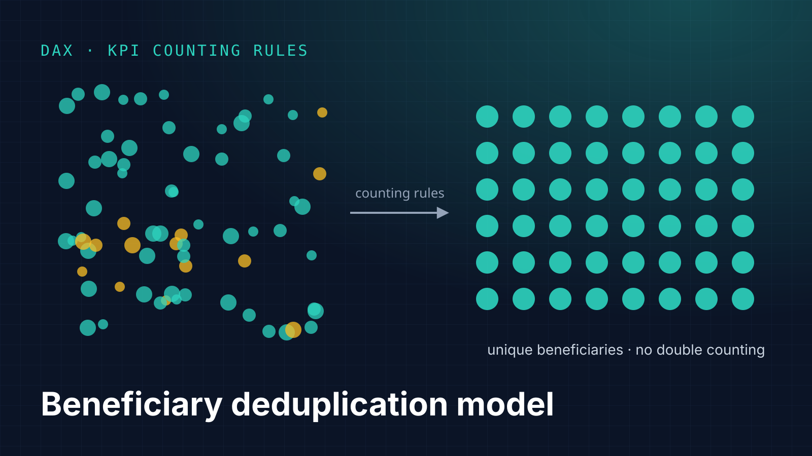

```{=html}
<div class="cs-hero"></div>
<div class="facts"><div class="fact"><div class="k">Organisation</div><div class="v">World Relief</div></div><div class="fact"><div class="k">Problem</div><div class="v">Double counting</div></div><div class="fact"><div class="k">Method</div><div class="v">DAX counting rules</div></div><div class="fact"><div class="k">Output</div><div class="v">Unique reach KPIs</div></div></div>
```

## The problem

One person can receive several services from several projects in one year. Summing reach across projects overstates the portfolio, which is a credibility risk in donor reporting.

## Approach

1. **Define the unit of count** for each indicator: unique individual, household or service contact.
2. **Build a stable person key** from available identifiers, with fallbacks when IDs are missing.
3. **Apply counting rules in the model**, not in the visuals, so every report inherits them.
4. **Show both views**: total services delivered *and* unique people reached, with the gap made visible.

```dax
Unique Beneficiaries Reached =
CALCULATE (
    DISTINCTCOUNT ( Reach[PersonKey] ),
    Reach[CountingRule] = "Unique individual",
    REMOVEFILTERS ( Reach[Service] )
)

Double-count Avoided =
[Total Service Contacts] - [Unique Beneficiaries Reached]
```

## Impact

- Reach figures follow written counting rules that donors can check.
- Projects and services can be combined without inflating totals.

```{=html}
<div class="btn-row" style="margin-top:2rem"><a class="btn-mo outline" href="../index.html">← All projects</a><a class="btn-mo outline" href="../../contact.html">Discuss a similar project</a></div>
```
