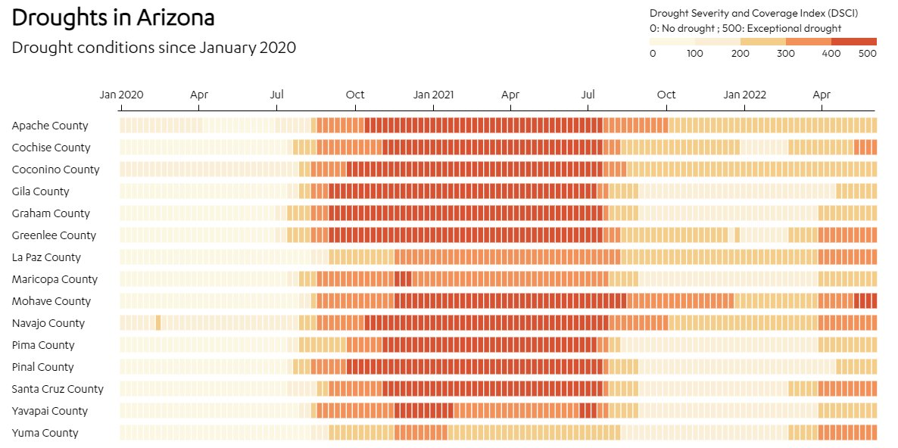
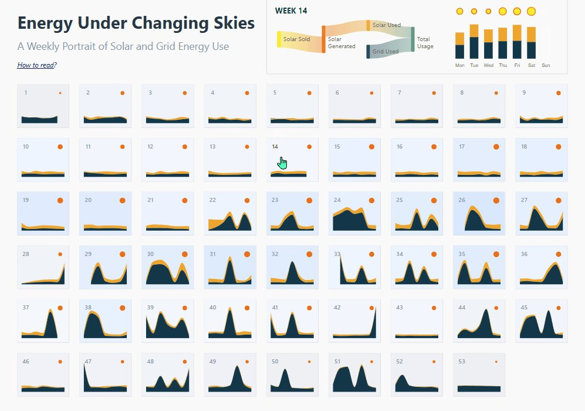

```{=html}
<div class="facts">
 <div class="fact"><div class="k">Tools</div><div class="v">Power BI · Deneb · Vega-Lite</div></div>
 <div class="fact"><div class="k">Visuals</div><div class="v">Heatmap · small multiples</div></div>
 <div class="fact"><div class="k">Why Deneb</div><div class="v">Charts Power BI can't do natively</div></div>
 <div class="fact"><div class="k">Format</div><div class="v">2-page storyboard</div></div>
</div>
```

Power BI's built-in visuals cover the basics. **Deneb** lets me write Vega-Lite specs inside a report, so I can build custom layouts that still filter, cross-highlight and refresh like any other visual.

## Visual 1 · Arizona's drought, week by week

{group="deneb"}

::: {.takeaway}
**What stands out:** drought arrives together. Almost every county darkens in the same weeks around August–October 2020, stays severe until July 2021, then eases sharply with the summer rains. Mohave holds on longest.
:::

**How it's built:** `rect` marks on a week × county grid, with a quantized colour scale in five steps so each shade means one severity level. A thin gap between cells keeps individual weeks readable without gridlines.

## Visual 2 · Energy under changing skies

{group="deneb"}

::: {.takeaway}
**What stands out:** two halves of the year. Weeks 1–21 are low and flat, and from week 22 demand jumps into tall peaks. Solar covers only a thin layer, and the sunniest weeks fall in the quietest period.
:::

**How it's built:** faceted area charts (one facet per week) with layered grid and solar areas and a sized circle for weekly generation. The hover panel combines a flow diagram and daily stacked bars.

```{=html}
<div class="btn-row" style="margin-top:1.6rem">
 <a class="btn-mo primary" href="storyboard.pdf"><i class="bi bi-file-earmark-pdf"></i> Download the storyboard (PDF)</a>
 <a class="btn-mo outline" href="../index.html">← All projects</a>
</div>
```
