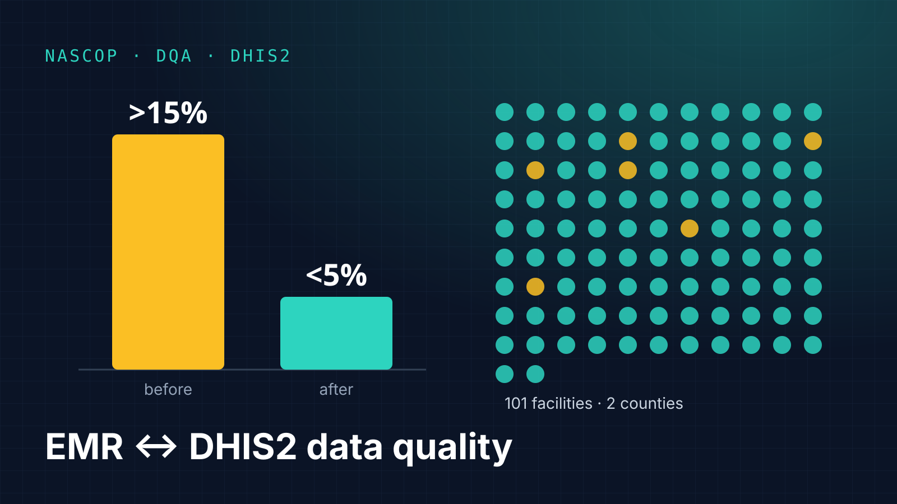

```{=html}
<div class="cs-hero"></div>
<div class="facts"><div class="fact"><div class="k">Organisation</div><div class="v">NASCOP</div></div><div class="fact"><div class="k">Facilities</div><div class="v">101 in 2 counties</div></div><div class="fact"><div class="k">Discrepancy</div><div class="v">>15% → <5%</div></div><div class="fact"><div class="k">Completeness</div><div class="v">90%+</div></div></div>
```

## The problem

HIV programme numbers reported in DHIS2 did not match what facility EMR systems held. Gaps of more than 15% weakened trust in the national data.

## Approach

- **Routine reconciliation** of EMR exports against DHIS2 monthly reports, indicator by indicator.
- **Verification visits** to facilities with the largest or most persistent gaps.
- **Corrective feedback and mentorship** for facility staff on national tools and reporting standards.
- **EMR rollout support**, helping facilities adopt the EMR and make better use of it.

```{=html}
<svg viewBox="0 0 640 230" width="100%" role="img" aria-label="Discrepancy before and after">
 <line x1="60" y1="190" x2="600" y2="190" stroke="currentColor" opacity=".25"/>
 <rect x="120" y="40" width="140" height="150" rx="8" fill="#f59e0b"/><text x="190" y="30" text-anchor="middle" font-weight="700" fill="currentColor">&gt;15%</text>
 <rect x="380" y="140" width="140" height="50" rx="8" fill="#0f766e"/><text x="450" y="130" text-anchor="middle" font-weight="700" fill="currentColor">&lt;5%</text>
 <text x="190" y="214" text-anchor="middle" font-size="13" fill="currentColor" opacity=".7">Before</text>
 <text x="450" y="214" text-anchor="middle" font-size="13" fill="currentColor" opacity=".7">After</text>
</svg>
```

## Impact

- Discrepancy cut from **over 15% to under 5%** across **101 facilities**.
- Reporting completeness held at **90% or more**.

```{=html}
<div class="btn-row" style="margin-top:2rem"><a class="btn-mo outline" href="../index.html">← All projects</a><a class="btn-mo outline" href="../../contact.html">Discuss a similar project</a></div>
```
