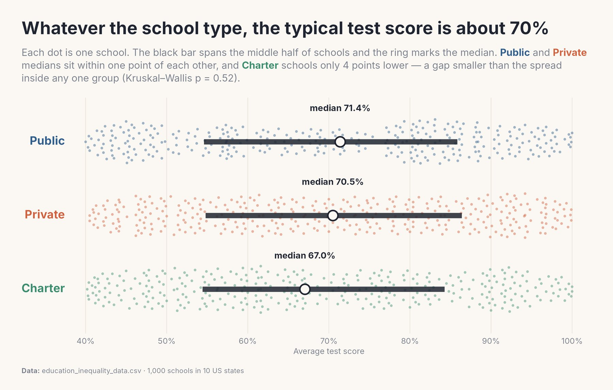
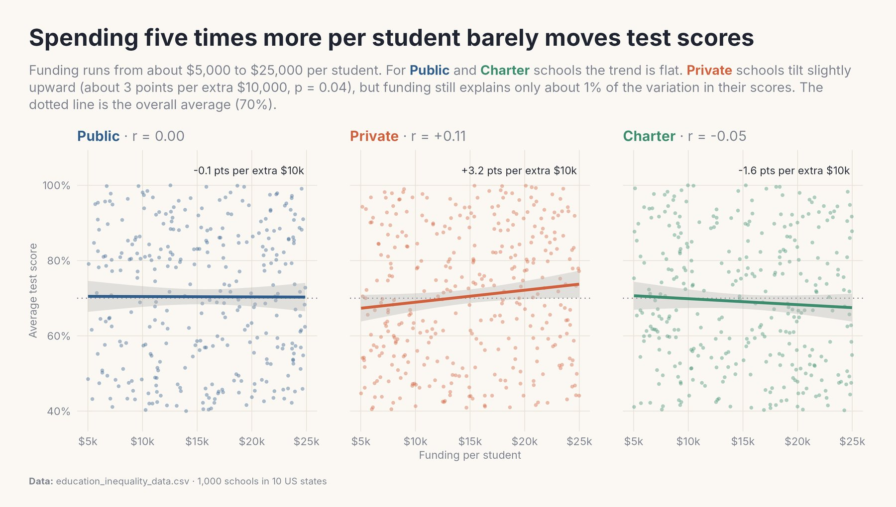
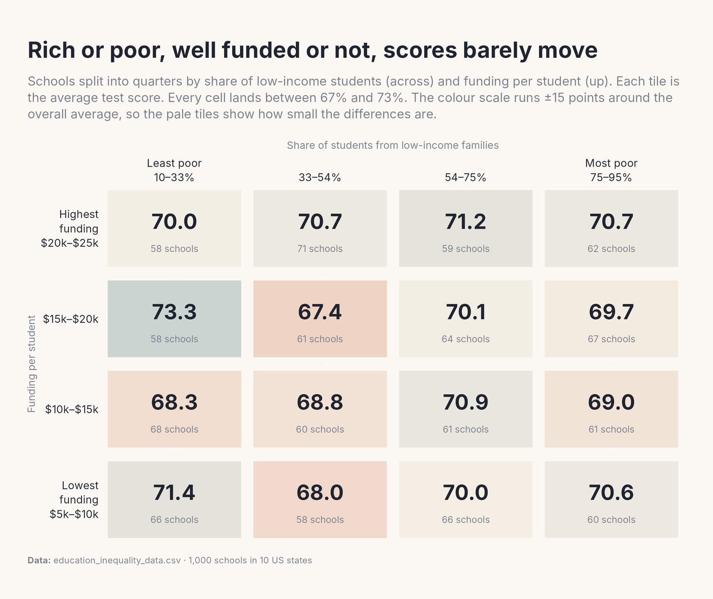
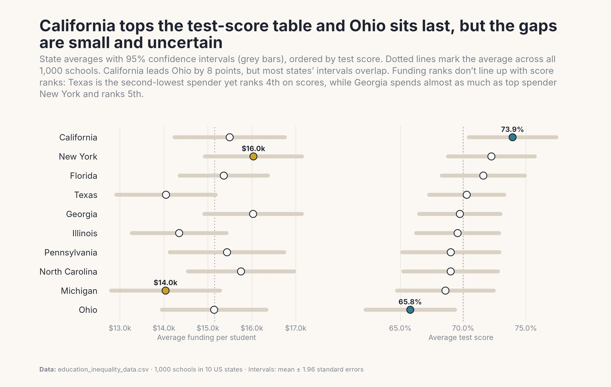

```{=html}
<div class="facts">
 <div class="fact"><div class="k">Tools</div><div class="v">R · ggplot2 · ggtext</div></div>
 <div class="fact"><div class="k">Data</div><div class="v">1,000 schools · 10 US states</div></div>
 <div class="fact"><div class="k">Format</div><div class="v">4 charts + 5-page storyboard</div></div>
 <div class="fact"><div class="k">Finding</div><div class="v">No real gap by type, funding or poverty</div></div>
</div>
```

The usual story about schools is that money and income decide results. This dataset says otherwise. Across every cut I tried, scores sit close to 70%. The design challenge was to **show a flat result honestly**, letting the absence of a gap be the headline rather than inventing one.

## Frame 1 · Start with the scores

{group="edu"}

::: {.takeaway}
**Takeaway:** medians are 71.4% (public), 70.5% (private) and 67.0% (charter), but the spread *within* each type dwarfs the gap *between* them (Kruskal–Wallis p = 0.52).
:::

## Frame 2 · Follow the money

{group="edu"}

::: {.takeaway}
**Takeaway:** spending five times more per student barely moves scores. Only private schools tilt upward, about 3 points per extra $10,000, and funding explains around 1% of the variation.
:::

## Frame 3 · Does poverty change the picture?

{group="edu"}

::: {.takeaway}
**Takeaway:** all 16 groups average between 67% and 73%. The poorest, least-funded group (70.6%) scores about the same as the best-off, best-funded group (70.0%). That's unusual next to most real-world studies.
:::

## Frame 4 · Where a school is

{group="edu"}

::: {.takeaway}
**Takeaway:** California (73.9%) and Ohio (65.8%) are the only clear gap. Spending and results don't line up: Texas is the second-lowest spender but ranks 4th on scores.
:::

## Design choices

- **Titles state the finding**, so a reader who sees only the headline still gets the point.
- **Colour replaces the legend.** School types are coloured inside the subtitle text with `ggtext`.
- **Uncertainty is visible.** Interquartile bars, trend-line bands and confidence intervals show how sure each comparison is.
- **One warm, quiet palette** across all four frames, so the set reads as a single story.

```{=html}
<div class="btn-row" style="margin-top:1.6rem">
 <a class="btn-mo primary" href="storyboard.pdf"><i class="bi bi-file-earmark-pdf"></i> Download the storyboard (PDF)</a>
 <a class="btn-mo outline" href="../index.html">← All projects</a>
</div>
```
