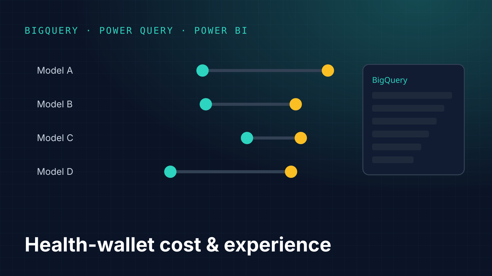

```{=html}
<div class="cs-hero"></div>
<div class="facts"><div class="fact"><div class="k">Client</div><div class="v">Moses Analytics</div></div><div class="fact"><div class="k">Source</div><div class="v">Google BigQuery</div></div><div class="fact"><div class="k">Data</div><div class="v">Long-format survey</div></div><div class="fact"><div class="k">Output</div><div class="v">Power BI report</div></div></div>
```

## The question

Do different digital health-wallet payment models change what patients pay and how they rate their care?

## What I did

- **Connected Power BI to Google BigQuery** and shaped long-format survey responses into an analysis-ready model in Power Query: question metadata, response values and respondent dimensions.
- **Built comparison measures** for cost and experience scores by payment model, with filters for facility and respondent group.
- **Designed the report** around the decision, not the dataset: a headline comparison first, drill-downs second.

```sql
-- shape responses before import
SELECT respondent_id, payment_model, question_code,
       SAFE_CAST(response_value AS FLOAT64) AS value
FROM   `project.survey.responses`
WHERE  question_code IN ('cost_total', 'satisfaction')
```

::: {.note-box}
Client work. The visuals here are illustrative, and client data stays private.
:::

```{=html}
<div class="btn-row" style="margin-top:2rem"><a class="btn-mo outline" href="../index.html">← All projects</a><a class="btn-mo outline" href="../../contact.html">Discuss a similar project</a></div>
```
