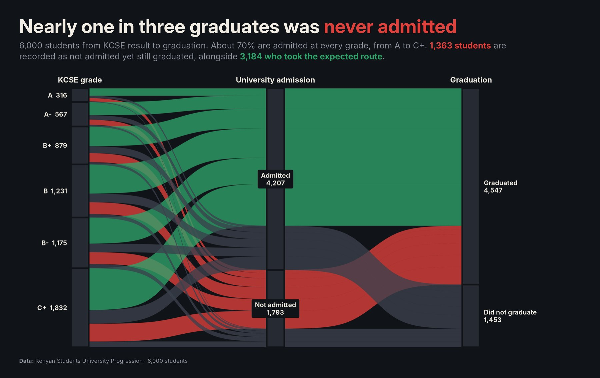
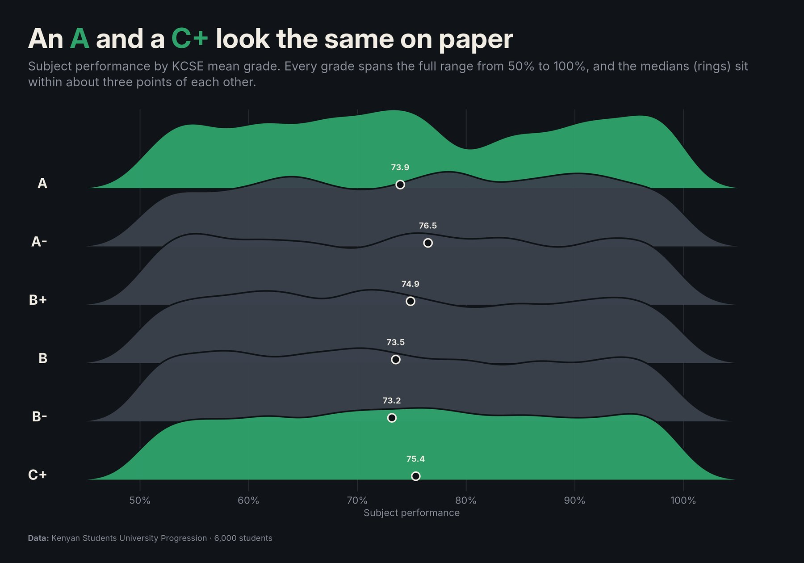
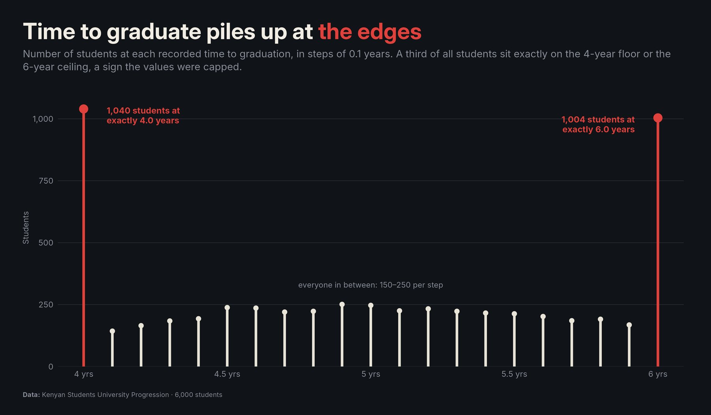
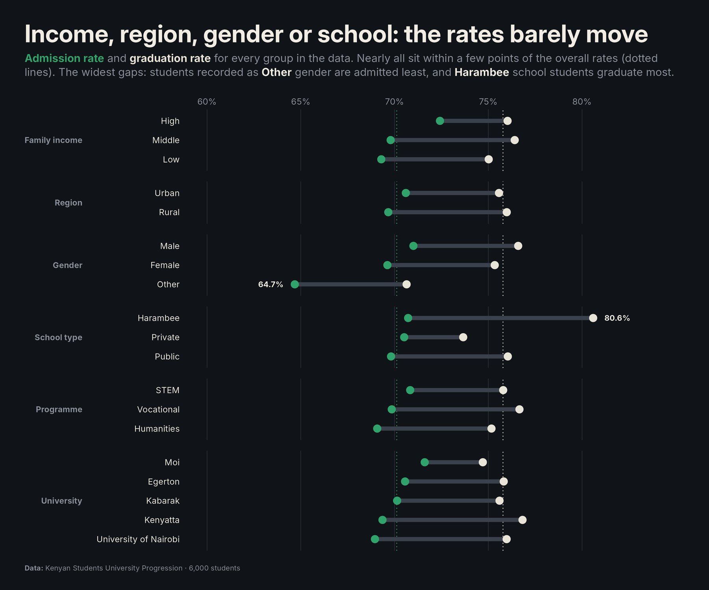

```{=html}
<div class="facts">
 <div class="fact"><div class="k">Tools</div><div class="v">R · ggplot2 · ggalluvial · ggridges</div></div>
 <div class="fact"><div class="k">Data</div><div class="v">6,000 students · 5 universities</div></div>
 <div class="fact"><div class="k">Format</div><div class="v">4 charts + 5-page storyboard</div></div>
 <div class="fact"><div class="k">Headline</div><div class="v">70% admitted · 76% graduated</div></div>
</div>
```

A dark palette drawn from the Kenyan flag, and four chart types, each chosen for one question: a **flow diagram** for the route, **ridgelines** for grades, a **lollipop histogram** for time, and **dumbbells** for groups.

The charts also work as a **data-quality audit**. They surface records that can't be true, and a good analyst says so instead of hiding it.

## 01 · The route

{group="ke"}

::: {.takeaway}
**Takeaway:** 1,363 students are recorded as graduating *without being admitted*, nearly one in three graduates. That points to a data problem, not a policy one.
:::

## 02 · The grades

{group="ke"}

::: {.takeaway}
**Takeaway:** an A and a C+ look the same on paper. Every grade spans 50–100%, and the medians sit within about three points of each other.
:::

## 03 · The clock

{group="ke"}

::: {.takeaway}
**Takeaway:** a third of students sit exactly on the 4-year floor or the 6-year ceiling, a sign the values were capped.
:::

## 04 · The groups

{group="ke"}

::: {.takeaway}
**Takeaway:** income, region, gender and school barely move the rates. The widest gaps are "Other" gender (lowest admission) and Harambee schools (highest graduation).
:::

## Design choices

- **Highlight colour carries meaning.** Green marks the expected route and red the anomaly, used the same way in every chart.
- **Annotate the outliers directly** (1,040 students at exactly 4.0 years) instead of leaving readers to find them.
- **Dark background** with the flag stripe for a recognisably Kenyan look.

```{=html}
<div class="btn-row" style="margin-top:1.6rem">
 <a class="btn-mo primary" href="storyboard.pdf"><i class="bi bi-file-earmark-pdf"></i> Download the storyboard (PDF)</a>
 <a class="btn-mo outline" href="../index.html">← All projects</a>
</div>
```
