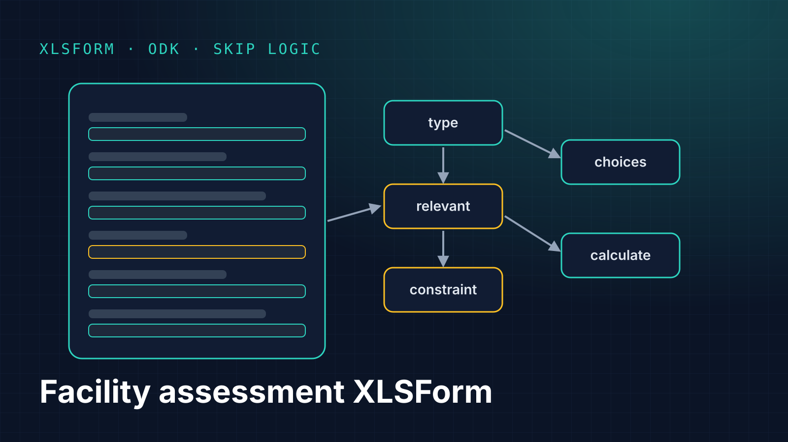

```{=html}
<div class="cs-hero"></div>
<div class="facts"><div class="fact"><div class="k">Organisation</div><div class="v">World Relief</div></div><div class="fact"><div class="k">Programme</div><div class="v">Malawi</div></div><div class="fact"><div class="k">Tool</div><div class="v">XLSForm (ODK/ONA)</div></div><div class="fact"><div class="k">Extras</div><div class="v">Manual · DQA plan</div></div></div>
```

## Design principles

- **Validate at the point of entry.** Constraints and required fields catch errors before data leaves the tablet.
- **Ask only what applies.** `relevant` logic hides questions that don't fit the facility.
- **Name things for analysis.** Variable names and choice lists are set up for Power BI and R from the start.

| type | name | label | relevant | constraint |
|---|---|---|---|---|
| select_one yn | has_water | Does the facility have a functioning water source? | | |
| select_one source | water_source | Main water source | `${has_water} = 'yes'` | |
| integer | handwash_stations | Number of handwashing stations | `${has_water} = 'yes'` | `. >= 0 and . <= 50` |

## Deliverables

XLSForm, enumerator manual, pilot feedback log and DQA plan.

```{=html}
<div class="btn-row" style="margin-top:2rem"><a class="btn-mo outline" href="../index.html">← All projects</a><a class="btn-mo outline" href="../../contact.html">Discuss a similar project</a></div>
```
