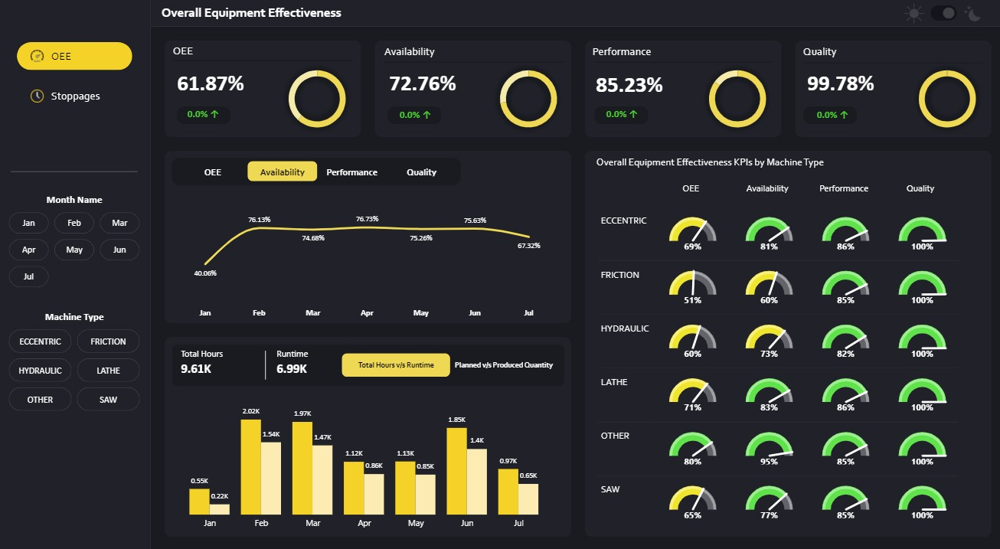

```{=html}
<div class="facts">
 <div class="fact"><div class="k">Tool</div><div class="v">Power BI · DAX</div></div>
 <div class="fact"><div class="k">Domain</div><div class="v">Manufacturing efficiency</div></div>
 <div class="fact"><div class="k">Pages</div><div class="v">OEE · Stoppages</div></div>
 <div class="fact"><div class="k">Status</div><div class="v">Live, interactive</div></div>
</div>
<div class="btn-row" style="margin:0 0 1.4rem">
 <a class="btn-mo primary" href="https://app.powerbi.com/view?r=eyJrIjoiYzdhNWFhZDctNDdiMy00OTRmLWJmMWQtY2Y1M2JhNzQ3MGJjIiwidCI6ImU4ZjAzNDIxLWFjZGItNDE5MC04N2M0LTJlNDVkYWNkMmQxYSIsImMiOjF9" target="_blank" rel="noopener"><i class="bi bi-box-arrow-up-right"></i> Open the live dashboard</a>
</div>
```

**Overall Equipment Effectiveness (OEE)** is the standard measure of how well a factory uses its machines. It multiplies three ratios: **availability** (was the machine running?), **performance** (was it running at full speed?) and **quality** (were the parts good?). This dashboard shows all three, so a manager can see *where* the losses come from rather than just how big they are.

## The dashboard

{group="oee"}

```{=html}
<div class="embed-wrap">
  <iframe title="Overall Equipment Effectiveness – Power BI" loading="lazy" allowfullscreen
    src="https://app.powerbi.com/view?r=eyJrIjoiYzdhNWFhZDctNDdiMy00OTRmLWJmMWQtY2Y1M2JhNzQ3MGJjIiwidCI6ImU4ZjAzNDIxLWFjZGItNDE5MC04N2M0LTJlNDVkYWNkMmQxYSIsImMiOjF9"></iframe>
</div>
<p class="muted small">Interactive version above. Use the month and machine-type buttons on the left. If it doesn't load, use <b>Open the live dashboard</b>.</p>
```

## What it shows

::: {.takeaway}
**Takeaway:** overall OEE is **61.87%**, and **availability (72.76%) is the main drag**. Performance (85.23%) and quality (99.78%) are strong, so the biggest gain would come from reducing downtime, not from faster or better production.
:::

- **Availability is the weak link.** It starts at 40% in January, holds around 75–77% from February to June (peaking in April), then falls to 67% in July.
- **Friction machines need attention.** They have the lowest OEE (51%), held back by availability of only 60%.
- **"Other" machines perform best**, with OEE of 80% and availability of 95%.
- **Quality is near-perfect everywhere**, at 100% for every machine type.
- **Hours vs runtime:** February and March have the most scheduled hours (2.02K and 1.97K). The gap between total hours and runtime in each month is the downtime that drives availability down.

## How it's built

- **KPI cards with ring charts** for OEE and its three components, with change versus the previous period.
- **Switchable trend chart.** Buttons swap the line chart between OEE, availability, performance and quality without leaving the page.
- **Switchable comparison.** The bar chart toggles between *total hours vs runtime* and *planned vs produced quantity*.
- **A gauge matrix**, machine type × metric, so the weakest cell stands out in yellow against green.
- **Button-style slicers** for month and machine type, a light/dark theme toggle, and a separate *Stoppages* page for root-cause detail.

```{=html}
<div class="btn-row" style="margin-top:1.6rem">
 <a class="btn-mo primary" href="https://app.powerbi.com/view?r=eyJrIjoiYzdhNWFhZDctNDdiMy00OTRmLWJmMWQtY2Y1M2JhNzQ3MGJjIiwidCI6ImU4ZjAzNDIxLWFjZGItNDE5MC04N2M0LTJlNDVkYWNkMmQxYSIsImMiOjF9" target="_blank" rel="noopener"><i class="bi bi-box-arrow-up-right"></i> Open the live dashboard</a>
 <a class="btn-mo outline" href="../index.html">← All projects</a>
</div>
```
