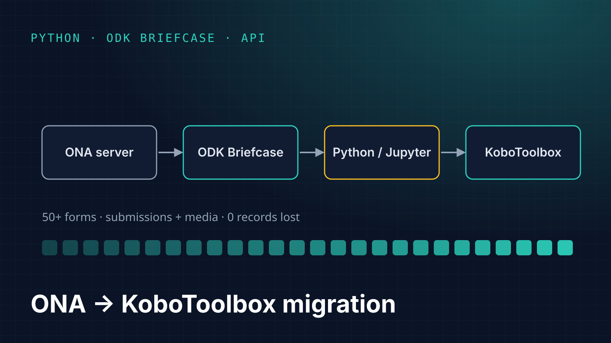

```{=html}
<div class="cs-hero"></div>
<div class="facts"><div class="fact"><div class="k">Organisation</div><div class="v">World Relief</div></div><div class="fact"><div class="k">Volume</div><div class="v">50+ forms</div></div><div class="fact"><div class="k">Data loss</div><div class="v">0 records</div></div><div class="fact"><div class="k">Stack</div><div class="v">ODK Briefcase · Python</div></div></div>
```

## The problem

Programmes were moving from ONA to KoboToolbox. Re-entering historical submissions by hand was not an option, and neither was losing them.

## Pipeline

```{=html}
<div class="flow">
 <div class="step"><b>1 · Export</b><span>Pull submissions and media from ONA with ODK Briefcase</span></div><div class="arrow">→</div>
 <div class="step"><b>2 · Match</b><span>Deploy the same XLSForm on Kobo and check field names line up</span></div><div class="arrow">→</div>
 <div class="step"><b>3 · Upload</b><span>Python notebook posts each submission XML to the Kobo API</span></div><div class="arrow">→</div>
 <div class="step"><b>4 · Reconcile</b><span>Compare counts and IDs, source against target</span></div>
</div>
```

```python
import requests, pathlib

KOBO = "https://kf.kobotoolbox.org"
headers = {"Authorization": f"Token {API_TOKEN}"}

for xml in pathlib.Path("briefcase/instances").rglob("submission.xml"):
    files = {"xml_submission_file": open(xml, "rb")}
    # attach media saved next to the submission
    for m in xml.parent.glob("*.jpg"):
        files[m.name] = open(m, "rb")
    r = requests.post(f"{KOBO}/api/v1/submissions", headers=headers, files=files)
    log(xml.parent.name, r.status_code)
```

*Simplified for illustration. The production notebook adds retries, duplicate checks and a reconciliation report.*

## Impact

- Submissions from **50+ forms** transferred with **no data loss**.
- Documented and reusable for later migrations.

```{=html}
<div class="btn-row" style="margin-top:2rem"><a class="btn-mo outline" href="../index.html">← All projects</a><a class="btn-mo outline" href="../../contact.html">Discuss a similar project</a></div>
```
