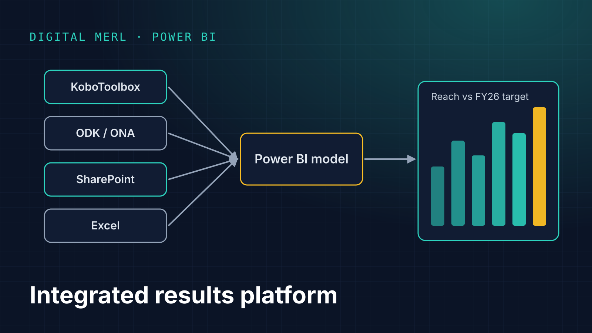

```{=html}
<div class="cs-hero"></div>
<div class="facts"><div class="fact"><div class="k">Organisation</div><div class="v">World Relief</div></div><div class="fact"><div class="k">Role</div><div class="v">Designer & maintainer</div></div><div class="fact"><div class="k">Scope</div><div class="v">6 countries · 10+ projects</div></div><div class="fact"><div class="k">Stack</div><div class="v">Power BI · SharePoint · Kobo</div></div></div>
```

## The problem

Each country office reported reach in its own spreadsheet format, on its own schedule. Leadership had no single, current answer to a simple question: *how many people are we reaching against our strategy targets?* Monthly consolidation took about two weeks of manual copy-and-paste.

## What I built

```{=html}
<div class="flow">
 <div class="step"><b>Collect</b><span>KoboToolbox / ODK forms, SharePoint trackers, Excel workbooks</span></div><div class="arrow">→</div>
 <div class="step"><b>Validate</b><span>Constraints at entry, Power Query checks, DQA review</span></div><div class="arrow">→</div>
 <div class="step"><b>Model</b><span>Star schema: fact reach, dimension project, country, indicator, date</span></div><div class="arrow">→</div>
 <div class="step"><b>Report</b><span>Reach vs target dashboards, drill-through by country and project</span></div>
</div>
```

- **One data model** fed by every source, with shared dimension tables for country, project, indicator and fiscal period (Oct–Sep fiscal year).
- **Indicator definitions and counting rules** documented once and applied in DAX, so every page counts the same way.
- **Role-based access** through Power BI workspaces and SharePoint permissions, so country teams see their data and leadership sees the portfolio.
- **Companion dashboards** on the same pattern: WASH health-facility assessment (ONA/ODK) and an HR staff tracker.

## Sample measure

```dax
Reach vs Target % =
VAR _reach  = [Unique Beneficiaries Reached]
VAR _target = SUM ( Targets[FY26 Target] )
RETURN DIVIDE ( _reach, _target )
```

## Impact

- Monthly reporting turnaround cut from **14 days to 7**.
- **10+ interactive dashboards** in routine use by programme and leadership staff.
- Country indicators aligned to the organisational Impact Framework and DMEAL guidance.

```{=html}
<div class="btn-row" style="margin-top:2rem"><a class="btn-mo outline" href="../index.html">← All projects</a><a class="btn-mo outline" href="../../contact.html">Discuss a similar project</a></div>
```
